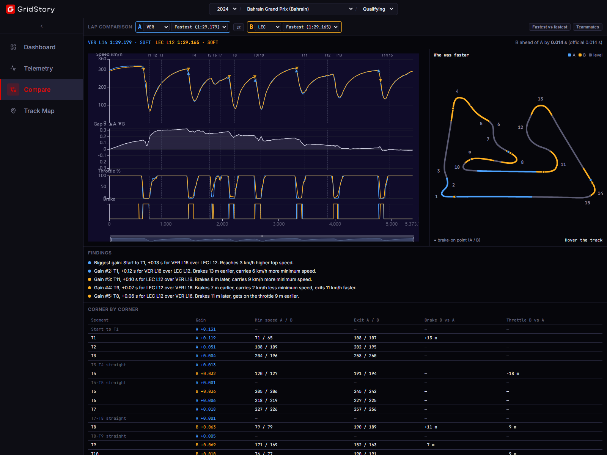

# GridStory

**Race engineering intelligence for Formula 1.** GridStory turns raw FastF1 telemetry into interactive race analysis, and explains where the time was won or lost instead of only charting it.

**Live demo:** https://akshat-tiwari69.github.io/gridstory/ (a static snapshot; see its exact comparison limits below).

**Portfolio:** [tiwaribabu.in/projects/](https://tiwaribabu.in/projects/)

> Unofficial fan project. Not affiliated with Formula 1, the FIA or any team. F1 and Formula 1 are trademarks of Formula One Licensing B.V.



## Comparing laps

Choose a year, event and session, then open **Compare**. Select driver and lap independently for A and B, or use **Fastest vs fastest** or **Teammates**. The swap button exchanges the sides when the reversed pair is available. Local API mode supports two laps of the same driver; selections are stored in the URL for sharing and reload.

The gap is elapsed time B minus elapsed time A at the same distance: positive means B is behind A. Segment gain identifies the side that gained time in that segment; positive brake/throttle differences mean B acted later. The chart, map, findings and corner table show the same comparison. Hover the map or chart to inspect distance.

Telemetry is sampled at roughly 4 Hz and resampled to a 5 m grid; small brake/throttle differences are suppressed at native sample resolution. Brake is on/off, not pressure. Missing channels, incomplete laps and alignment limitations are reported in the view; if telemetry does not reach the finish, no finish gap is claimed. See [comparison API and caveats](docs/lap-comparison-api.md).

The static demo has no API. Its export lists 2024 Bahrain qualifying and race, 2024 Saudi Arabian race, and 2025 Australian race. It includes fastest-lap telemetry and successfully exported ordered comparisons among the five quickest drivers and teammate pairs only. Lap pickers are disabled, unavailable pairs cannot be compared, and it cannot fetch other sessions or arbitrary laps. The linked public deployment may not yet contain the latest local comparison build.

## Repository layout

```
apps/
  api/        FastAPI service — loads FastF1 sessions and serves timing, telemetry, weather, race control
  web/        React + Vite + TypeScript dashboard (ECharts, Three.js)
docs/
  VISION.md   Product vision
  ROADMAP.md  Phased development plan
  RESOURCES.md  Data sources, references and inspiration, with licences
  design/     Reference UI, icons and screenshots
Makefile      Dev shortcuts (Windows)
```

## Getting started

Requires Python 3.11+ and Node 20+.

### API (`apps/api`)

```bash
cd apps/api
python -m venv .venv
.venv/Scripts/python -m pip install -r requirements.txt
.venv/Scripts/python -m uvicorn app.main:app --reload --port 8000
```

Interactive docs at http://localhost:8000/docs. Cached sessions are read from `app/f1_cache/` (gitignored); do not clear it. Uncached sessions use the available data sources described below, subject to archive coverage.

### Web (`apps/web`)

```bash
cd apps/web
npm install
npm run dev
```

Opens on http://localhost:5173 and talks to the API on port 8000.

### Make targets

| Target      | What it does                         |
|-------------|--------------------------------------|
| `make dev`  | Start API and web in separate windows |
| `make api`  | Start the API only                    |
| `make web`  | Start the web app only                |
| `make test` | Run API tests                         |
| `make lint` | Ruff (API) + ESLint (web)             |

## Data sources and credits

- **[FastF1](https://github.com/theOehrly/Fast-F1)** (MIT): timing, telemetry, weather and race control from F1's live-timing archive. Since ~15 Oct 2026 that archive needs an F1 TV login ([Fast-F1#978](https://github.com/theOehrly/Fast-F1/issues/978)), so FastF1 only serves sessions already in the local cache.
- **[TracingInsights Archive](https://github.com/TracingInsights-Archive)** (Apache-2.0, by [TracingInsights](https://tracinginsights.com/)): the fallback for everything FastF1 can't load. It covers lap times, per-lap telemetry, weather, race control, corners and team colours from 2018 to May 2026.
- **[Jolpica-F1](https://github.com/jolpica/jolpica-f1)** (Apache-2.0, via FastF1): session results.

More sources and references, and how GridStory uses them: [docs/RESOURCES.md](docs/RESOURCES.md).

## Warming the cache

A session's first load downloads and processes a lot of data. Warm a season ahead of time so the API only reads from disk:

```bash
cd apps/api
.venv/Scripts/python -m app.precompute 2024 --sessions R,Q
```

## Publishing the online demo

The demo on GitHub Pages has no backend: it is exported from the four cached sessions listed above. F1's timing archive has required an F1 TV login since Oct 2026 ([Fast-F1#978](https://github.com/theOehrly/Fast-F1/issues/978)); the local API also has a TracingInsights fallback through May 2026.

To publish it:

```bash
bash scripts/publish-demo.sh
```

It builds the web app in static mode, exports the sessions listed in `apps/api/scripts/export_demo.py` to JSON, and force-pushes the result to the `gh-pages` branch.

## Local smoke test

1. Start the API and web app using the commands above. Open the web URL and choose **2024 → Bahrain Grand Prix → Qualifying → Compare**.
2. Choose VER fastest for A and LEC fastest for B. The summary should show VER L16 (1:29.179), LEC L12 (1:29.165), and B ahead by 0.014 s. Inspect the gap trace, map, findings and corner table.
3. Swap A and B and check the gap reverses. Select a numbered lap and, locally, compare two laps of one driver. Reload the URL and check both selections remain.
4. In a static build, check that only exported sessions and pairs are offered and lap selectors are disabled. Verify an unsupported URL reports an unavailable pair.

Data availability can vary with cache and archive coverage; warnings and missing telemetry should be investigated rather than interpreted as a valid finish comparison.
